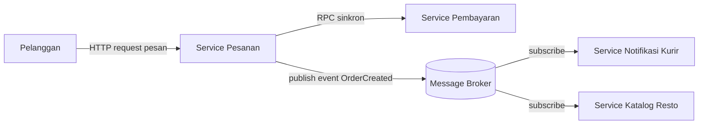
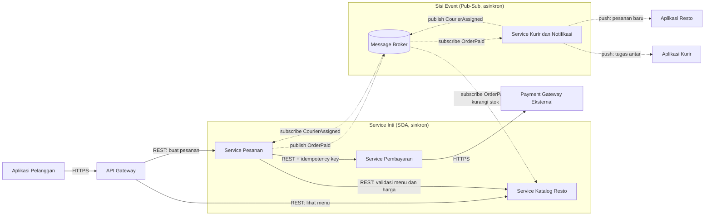

# Tugas 2 (Pekan 2) — Perancangan Arsitektur untuk FoodGo

**Materi terkait:** Architectural style (Layered, SOA, Peer-to-Peer, Publish-Subscribe).

## Studi Kasus

Melanjutkan Tugas 1: FoodGo butuh sistem yang **decoupled** agar tim kurir dan tim resto tidak saling mengganggu ketika salah satu modul diperbarui/deploy ulang. Saat ini semua modul (pesanan, pembayaran, notifikasi kurir, katalog resto) berjalan sebagai satu aplikasi monolitik — sekali deploy, semua modul ikut restart dan berisiko downtime total.

## Tugas Kelompok

1. Pilih **satu** gaya arsitektur utama: **Service-Oriented Architecture (SOA)** atau **Publish-Subscribe**. Boleh dikombinasikan (mis. SOA untuk service inti + Pub-Sub untuk notifikasi), tapi harus dijustifikasi kenapa kombinasi ini yang dipilih.
2. Gambarkan minimal 4 komponen berikut dan interaksinya: modul Pesanan, modul Pembayaran, modul Kurir/Notifikasi, modul Katalog Resto (dan message broker/API gateway jika relevan).
3. Jelaskan alur satu skenario penuh secara end-to-end di diagram (misalnya: pelanggan buat pesanan -> bayar -> resto terima notifikasi -> kurir ditugaskan) — tunjukkan komponen mana berkomunikasi dengan siapa, dan **jenis komunikasinya** (sinkron/asinkron, request-response/event).
4. Analisis tertulis: kenapa gaya ini mengatasi masalah *coupling* dari Tugas 1, dan apa trade-off-nya (mis. Pub-Sub menambah kompleksitas debugging karena alur tidak linear).

## Cara Membuat Diagram (Gratis, Cukup Laptop)

Tidak perlu software berbayar. Dua opsi:

**Opsi A — Mermaid di dalam Markdown (disarankan).** Ditulis sebagai teks biasa di `README.md`, otomatis dirender jadi diagram oleh GitHub — tidak perlu install apa pun.

````markdown

````

**Opsi B — draw.io / diagrams.net** (gratis, jalan di browser tanpa akun, atau app desktop offline di [app.diagrams.net](https://app.diagrams.net/)). Ekspor sebagai `.png` dan simpan di folder `diagram/`.

## Struktur Submission

```
tugas-02-perancangan-arsitektur/
├── README.md          # Analisis + diagram Mermaid (jika Opsi A) atau referensi ke diagram/
├── JURNAL.md
└── diagram/            # File .png/.drawio jika pakai Opsi B
```

## Rubrik Penilaian (Tugas 2)

| Komponen | Bobot | Kriteria |
|---|---|---|
| Ketepatan pemilihan gaya arsitektur | 20% | Justifikasi SOA/Pub-Sub sesuai kebutuhan *decoupling* di skenario |
| Kelengkapan & kejelasan diagram | 30% | Semua komponen kunci ada, jenis komunikasi (sinkron/asinkron) jelas ditandai |
| Analisis trade-off | 30% | Bukan hanya kelebihan — kekurangan/kompleksitas baru juga dibahas |
| Proses & kontribusi kelompok | 20% | `JURNAL.md`, commit history |

## Batasan Penggunaan AI (Level 2)

Kebijakan **Level 2 (AI Assisted Idea Generation & Structuring)** berlaku — lihat [`../RUBRIK-UMUM.md`](../RUBRIK-UMUM.md). Boleh memakai AI untuk brainstorming komponen apa saja yang umum ada di gaya arsitektur SOA/Pub-Sub; **tidak boleh** meminta AI menggambar diagram final atau menuliskan analisis trade-off yang tinggal ditempel. Catat pemakaian AI di "Log Penggunaan AI" pada `JURNAL.md`.

- Diagram Mermaid/draw.io yang "terlalu generik" (identik dengan contoh tutorial di internet tanpa penyesuaian ke kasus FoodGo) akan dinilai rendah pada komponen kelengkapan & kejelasan diagram.
<br>
<br>

# JAWAB : 

## 1. Gaya Arsitektur yang Dipilih

Kami memilih **kombinasi SOA + Publish-Subscribe**:

- **SOA untuk jalur transaksi inti** (Pesanan, Pembayaran, Katalog Resto). Langkah-langkah ini butuh jawaban langsung dan berurutan. Pelanggan harus tahu seketika apakah menu valid dan pembayaran berhasil, sehingga pola *request-response* sinkron cocok.
- **Pub-Sub untuk efek samping setelah pesanan dibayar** (notifikasi ke resto, penugasan kurir, pengurangan stok, update status). Langkah-langkah ini tidak perlu memblokir pelanggan, dan sebaiknya tidak membuat Service Pesanan tahu siapa saja yang berkepentingan.

**Kenapa kombinasi, bukan salah satu saja?**

| Jika hanya... | Masalahnya untuk FoodGo |
|---|---|
| SOA murni (semua sinkron) | Service Pesanan harus memanggil Notifikasi dan Kurir secara langsung. Jika tim kurir men-*deploy* ulang atau service-nya lambat, proses pesanan ikut tertahan, sama persis dengan kegagalan *cascading* di Tugas 1. |
| Pub-Sub murni (semua event) | Pembayaran butuh kepastian hasil sebelum pesanan diteruskan, dan validasi menu/harga butuh jawaban langsung. Memaksa semuanya jadi event membuat alur checkout rumit dan status pesanan membingungkan pelanggan. |

Kombinasi ini menempatkan komunikasi sinkron hanya di tempat yang memang butuh kepastian, dan asinkron di tempat yang butuh keterlepasan (*decoupling*).

---

## 2. Diagram Komponen

Garis *solid* = komunikasi sinkron (request-response). <br>
Garis *putus-putus* = komunikasi asinkron (event / push).



**Catatan desain:**

- Database per service. Pesanan, Pembayaran, dan Katalog masing-masing punya penyimpanan sendiri. Tidak ada service yang membaca tabel milik service lain, hanya lewat API atau event.
- API Gateway menjadi satu pintu masuk untuk aplikasi pelanggan, sehingga perubahan alamat atau jumlah instance di belakangnya tidak terlihat oleh klien.
- Message Broker menyimpan event secara durable, jadi jika Service Notifikasi sedang di-deploy ulang, event tetap menunggu di antrean dan diproses setelah service kembali hidup.
- Panggilan sinkron memakai perlindungan dari Tugas 1: timeout, retry berbackoff untuk operasi idempotent, dan circuit breaker.

---